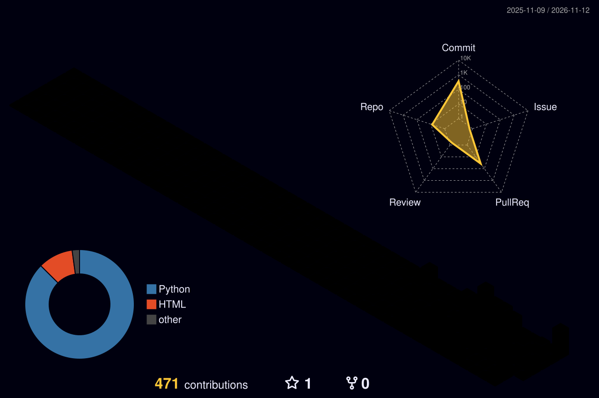

\<h1 align="center">Hi, I'm Mohamed Faizal 👋</h1>

<h3 align="center">Integrated M.Tech CSE (Business Analytics) @ VIT Chennai | Building AI & Blockchain Systems</h3>

  
  

---

### 📊 Contribution Overview

  

---

### 🧠 About Me

- 🎓 Integrated M.Tech CSE (Business Analytics) student, School of Computer Science and Engineering, VIT (Vellore Institute of Technology)
- 🔭 Currently building **ML/NLP pipelines**, **blockchain-anchored document systems**, and **healthcare AI** for coursework and research
- 🌱 Learning: applied NLP, graph neural networks, and smart-contract-backed verification systems
- ⚡ Full-stack experience across FastAPI/React backends, ML pipelines, and blockchain-anchored systems

---

### 🚀 Featured Projects

#### ⛓️ [ProofChain](https://github.com/mohamed-faizal007/ProofChain)
Blockchain-anchored framework for verifiable document provenance and AI-assisted tamper localization in PDFs — SHA-256 hierarchical hashing, Merkle trees, blockchain anchoring, versioning, and NLP-based change classification.
`React` `FastAPI` `MongoDB` `AWS S3` `Blockchain`

#### 🔐 [GeoLegalVault](https://github.com/mohamed-faizal007/GeoLegalVault)
A geospatially-gated legal document integrity platform with a maker-checker workflow, GPS geofencing, and on-chain anchoring (Sepolia testnet) to make document approval tamper-evident.
`FastAPI` `React/TypeScript` `Solidity` `Hardhat` `web3.py` `Docker`

#### 🏛️ [Government-Scheme AI](https://github.com/mohamed-faizal007/Government_Scheme-AI)
Pipeline to extract structured, schema-validated JSON (benefits, eligibility, application process, FAQs) from India's government scheme PDFs, plus **SchemeBot**, a multilingual (English/Hindi/Tamil) chatbot built on top of the extracted data.
`Python` `NLP` `Sentence Embeddings` `Pydantic`

#### 🧠 Stroke-Triage AI
AI system for stroke triage on the ISLES'24 CT dataset, combining a Circle-of-Willis knowledge graph with a GNN to predict occlusion location and collateral grade alongside vessel segmentation. *(In progress — not yet public.)*
`PyTorch` `Graph Neural Networks` `Medical Imaging`

---

### 🛠️ Tech Stack

<b>Languages</b> 

<b>AI / ML</b> 

<b>Backend / Infra</b> 

---

  

